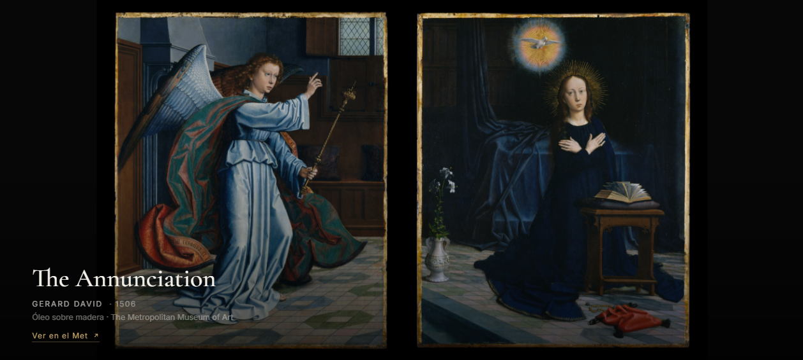
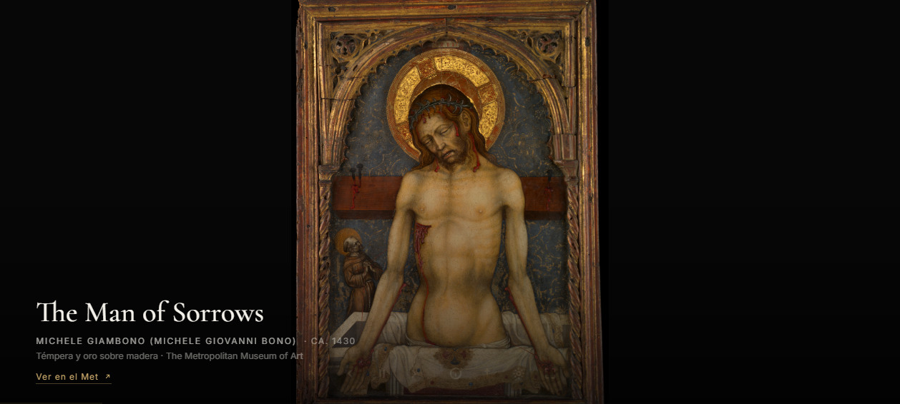

# Met Gallery · Pinturas Europeas

Un screensaver de arte para el navegador: slideshow a pantalla completa con las pinturas europeas del [The Metropolitan Museum of Art](https://www.metmuseum.org), servidas en alta resolución por su API pública Open Access.

## Características

- Más de **2.600 pinturas europeas** del Met (imágenes Open Access en resolución original, varias de más de 3000 px).
- Transiciones con crossfade y efecto **Ken Burns** (zoom y paneo lentos).
- **Ficha de cada obra**: título, artista, fecha y técnica, con enlace a la página oficial en el Met.
- **Modo screensaver**: los controles y el cursor se ocultan solos tras unos segundos de inactividad.
- Ajustes persistentes (localStorage):
  - Duración por obra (5–120 s)
  - Calidad de imagen: original o web (carga rápida)
  - Encuadre: obra completa (bandas negras) o llenar pantalla (modo wallpaper)
  - Colección: toda la galería o solo las obras destacadas del Met
- Carga por lotes en segundo plano y precarga de las próximas imágenes: sin cortes entre obras.
- Wake Lock API: en pantalla completa, evita que el monitor se apague.
- **Filtro de pinturas religiosas**: toggle en la barra inferior (o tecla `R`) que limita la galería a la iconografía cristiana (Madonnas, santos, crucifixiones, natividades…), detectada por los tags de tema del Met.

## Uso local

Abrí `index.html` en cualquier navegador moderno. No requiere servidor, build ni claves: todo corre en el cliente contra la API pública del Met (solo necesita internet).

| Atajo | Acción |
|---|---|
| `←` / `→` | Obra anterior / siguiente |
| `Espacio` | Pausar / reanudar |
| `F` o doble clic | Pantalla completa |
| `I` | Fijar la ficha de la obra |
| `R` | Solo pinturas religiosas |
| `Esc` | Cerrar ajustes |

## Deploy

Es un sitio **100% estático** (un solo `index.html` sin dependencias): cualquier hosting estático lo sirve.

### Render (Static Site)

Opción A — Dashboard: **New → Static Site** → este repo → Build Command **vacío** → Publish Directory `.`.

Opción B — Blueprint (este repo incluye `render.yaml`): **New → Blueprint** → este repo. Render crea el Static Site automáticamente, con HTTPS y subdominio `onrender.com`.

### GitHub Pages (alternativa)

Settings → Pages → Deploy from a branch → `main` / root. Cero configuración adicional.

## Cómo funciona

- **Listado de obras**: `/public/collection/v1.1/search?departmentId=11&hasImages=true&medium=Paintings` — endpoint v1.1 (paginado con `offset`/`limit`); el endpoint `/v1/search` se retiró en octubre de 2026. El filtro `medium=Paintings` deja fuera los marcos y dibujos que el departamento también contiene.
- **Detalle e imagen**: `/public/collection/v1/objects/{id}` → `primaryImage` (original) y `primaryImageSmall` (web).
- Las imágenes se muestran en caliente desde `images.metmuseum.org`; este repo no copia ni almacena ninguna imagen.
- **Filtro religioso**: client-side, sobre el campo `tags` de cada obra (vocabulario de temas del Met: *Christ*, *Virgin Mary*, *Saints*, *Nativity*, *Crucifixion*, *Madonna and Child*, etc.).

## Créditos

- Datos e imágenes: [The Met Open Access](https://www.metmuseum.org/information/open-access) — CC0 1.0 (dominio público).
- Este proyecto no está afiliado a The Metropolitan Museum of Art.

## Licencia

Código bajo [MIT](LICENSE).
